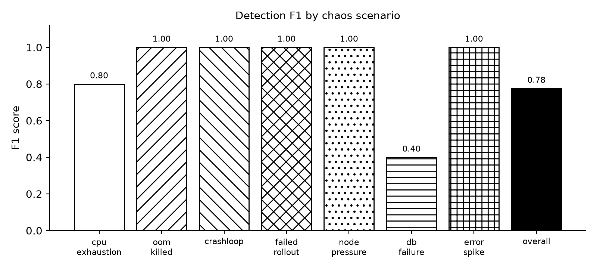

# Evaluation results

Generated 2026-10-16 14:01:24 UTC from 24 injections in `chaos/injections.jsonl` and 36 incidents in MongoDB (2026-10-16 08:35:33 → 2026-10-16 12:51:28).

A detection (TP) is an incident of the injected workload overlapping [start, end + 3 min]. Duplicates are extra incidents for an already-detected injection (not counted as FP). error_spike is a separate validation row, not part of Overall.

## Detection

| Scenario | Injections | TP | FP | FN | Dup | Precision | Recall | F1 |
|---|---:|---:|---:|---:|---:|---:|---:|---:|
| cpu_exhaustion | 5 | 4 | 1 | 1 | 0 | 0.80 | 0.80 | 0.80 |
| oom_killed | 3 | 3 | 0 | 0 | 0 | 1.00 | 1.00 | 1.00 |
| crashloop | 3 | 3 | 0 | 0 | 0 | 1.00 | 1.00 | 1.00 |
| failed_rollout | 3 | 3 | 0 | 0 | 0 | 1.00 | 1.00 | 1.00 |
| node_pressure | 3 | 3 | 0 | 0 | 3 | 1.00 | 1.00 | 1.00 |
| db_failure | 3 | 3 | 9 | 0 | 0 | 0.25 | 1.00 | 0.40 |
| error_spike | 4 | 4 | 0 | 0 | 0 | 1.00 | 1.00 | 1.00 |
| **Overall** | 20 | 19 | 10 | 1 | 3 | 0.66 | 0.95 | 0.78 |

## Diagnosis and timing

| Scenario | Kind correct | Diagnosed | RCA yes / partial / no | RCA accuracy | RCA weighted | MTTD mean (s) | MTTD max (s) | Gemini calls / incident (mean, max) |
|---|---:|---:|---:|---:|---:|---:|---:|---:|
| cpu_exhaustion | 25% | 4/4 | 0 / 2 / 2 | 0% | 25% | 42 | 59 | 1.00, 1 |
| oom_killed | 100% | 3/3 | 3 / 0 / 0 | 100% | 100% | 171 | 188 | 1.00, 1 |
| crashloop | 100% | 3/3 | 3 / 0 / 0 | 100% | 100% | 54 | 77 | 1.00, 1 |
| failed_rollout | 100% | 3/3 | 3 / 0 / 0 | 100% | 100% | 63 | 76 | 1.33, 2 |
| node_pressure | 100% | 3/3 | 3 / 0 / 0 | 100% | 100% | 103 | 121 | 1.00, 1 |
| db_failure | 67% | 3/3 | 3 / 0 / 0 | 100% | 100% | -273 | 84 | 1.00, 1 |
| error_spike | 75% | 4/4 | 3 / 0 / 1 | 75% | 75% | -666 | 43 | 1.00, 1 |

Grading rule: **yes** = the diagnosis names the injected cause; **partial** = it identifies CPU as the problem but not the load driving it; **no** = it blames a different cause. error_spike's injected cause is the app returning HTTP 500s from /spike-errors, so "application-level errors" counts as yes. Accuracy = yes ÷ graded; weighted = (yes + 0.5 × partial) ÷ graded. Rows in `rca_labels.csv` for incidents outside this evaluation (pre-evaluation test runs) are not counted.

RCA accuracy overall (Overall scenarios, excluding the error_spike validation row): 79% yes, 84% weighted, of 19 graded (15 yes / 2 partial / 2 no); including error_spike: 78% yes, 83% weighted, of 23. 0 diagnosed detection(s) still ungraded in `eval/rca_labels.csv`.

RCA diagnoses: 23 of 23 detections diagnosed, 0 skipped; model: `gemini-flash-lite-latest`. The pipeline ran with `--no-rca`; diagnoses were made afterwards by `eval/rca_backfill.py --priority-since` (fixed-code runs first, then the latest rounds), one call per detection.

23 of the diagnoses were made after the run by `eval/rca_backfill.py` (live RCA was off: Gemini free-tier quota), one call per detected injection — so for those incidents Gemini calls per incident is 1 by construction, not a measurement of the pipeline's re-diagnosis policy.

## Failure prediction lead time

First `predicted_exhaustion` warning → first OOMKilled restart, per detected injection.

| Scenario | Injections with a warning before the kill | mean (s) | min (s) | max (s) |
|---|---:|---:|---:|---:|
| oom_killed | 3/3 | 89 | 75 | 100 |

## Pipeline cycle time (seconds)

All cycles in `ml-engine/logs/cycle_times.jsonl` (every pipeline run logged on this machine).

| Cycles | n | mean | median | p95 | max |
|---|---:|---:|---:|---:|---:|
| without Gemini calls | 332 | 1.24 | 0.73 | 5.11 | 9.35 |
| with Gemini calls | 12 | 21.35 | 9.60 | 54.01 | 73.60 |
| with Gemini calls, minus Gemini time | 12 | 0.65 | 0.24 | 1.02 | 3.88 |

## Pipeline resource usage

pipeline.py sampled every 60 s during the experiment (192 samples, `ml-engine/logs/pipeline_usage.csv`). CPU is % of one core.

| Metric | mean | max |
|---|---:|---:|
| CPU % | 0.7 | 13.9 |
| Memory (working set, MB) | 109 | 224 |

## Flask scenarios on the fixed code only (injections after 2026-10-16 10:52:26 UTC, commit `ab5773b`)

A subset of the main table, same matching rules; see *Defect found during evaluation* below.

| Scenario | Injections | Detected | Recall | Kind correct | MTTD mean (s) | MTTD max (s) |
|---|---:|---:|---:|---:|---:|---:|
| cpu_exhaustion | 3 | 3 | 1.00 | 33% | 37 | 45 |
| error_spike | 3 | 3 | 1.00 | 67% | -4 | 43 |

flask-deployment false positives after the fix: 0.

## Defect found during evaluation

**What happened.** After a pipeline restart at 09:01:41 UTC, steady low/medium noise on flask-deployment (its error rate normally swings 7–13% and its memory drifts up slowly) kept one incident, `d4ac9d90`, open from 09:01:41 until the fix at ~10:52 — 100+ minutes and 230+ anomalies. Every new flask anomaly merged into it, and because it was always open it blocked every baseline refit, so the stale baseline kept producing the noise that kept it open.

**Runs affected** (all on the code before the fix):

- cpu_exhaustion round 2 (09:54): its CPU spike merged into `d4ac9d90`, which the matcher had already used for an earlier injection, so it scores as a **false negative**.
- error_spike round 1 (09:46): matched to `d4ac9d90`, which started 44 minutes before the injection, so its MTTD is **negative** and meaningless.
- db_failure round 2 (10:47): the same mechanism on demo-db-app — a noise incident (`46d6ede0`) open since 10:32 absorbed the injection. It was still detected with the right kind (db_connection), but its MTTD is negative.
- error_spike round 2 (10:59) started after the fix and is not affected.

**Fix** (commit `ab5773b`): an incident is closed after 10 minutes without a medium/high anomaly or Kubernetes signal, or at 30 minutes; a stale low/medium incident no longer blocks a refit, and its rows are used for the baseline (drift). The pipeline was restarted with the fix at 2026-10-16 10:52:26 UTC (in a cool-down), and two extra cpu_exhaustion rounds and one extra error_spike round were run so each has 3 runs on the fixed code (table above). Results were **not** re-scored and no incident was split after the fact: the tables above count the affected runs as they happened.

## Per injection

| # | Scenario | Start → end (UTC) | Detected by | MTTD (s) |
|---:|---|---|---|---:|
| 1 | cpu_exhaustion | 08:41:33 → 08:45:45 | `c0b88cbb` | 59 |
| 2 | oom_killed | 08:51:46 → 08:58:18 | `0b0b98c0` | 188 |
| 3 | crashloop | 09:04:19 → 09:08:31 | `660ee265` | 55 |
| 4 | failed_rollout | 09:14:35 → 09:18:36 | `323f0642` | 47 |
| 5 | node_pressure | 09:25:08 → 09:29:16 | `f4ca133c`, `b4706570` | 83 |
| 6 | db_failure | 09:35:17 → 09:39:20 | `fd70123a` | 21 |
| 7 | error_spike | 09:46:21 → 09:46:51 | `d4ac9d90` | -2649 |
| 8 | cpu_exhaustion | 09:54:23 → 09:58:31 | **not detected** | – |
| 9 | oom_killed | 10:04:32 → 10:11:04 | `62d94f2d` | 161 |
| 10 | crashloop | 10:17:06 → 10:21:08 | `d6d49e74` | 31 |
| 11 | failed_rollout | 10:27:12 → 10:31:14 | `12510c90` | 66 |
| 12 | node_pressure | 10:37:46 → 10:41:55 | `a5050b2b`, `38674331` | 121 |
| 13 | db_failure | 10:47:55 → 10:52:00 | `46d6ede0` | -925 |
| 14 | error_spike | 10:59:01 → 10:59:31 | `a2f465fa` | 41 |
| 15 | cpu_exhaustion | 11:07:04 → 11:11:11 | `b531c60e` | 45 |
| 16 | oom_killed | 11:17:12 → 11:23:44 | `8ec83d9a` | 164 |
| 17 | crashloop | 11:29:45 → 11:33:48 | `e2ea9488` | 77 |
| 18 | failed_rollout | 11:39:51 → 11:43:53 | `18c65622` | 76 |
| 19 | node_pressure | 11:50:26 → 11:54:54 | `3ff65cc0`, `24a92540` | 106 |
| 20 | db_failure | 12:00:55 → 12:04:59 | `157c3a6b` | 84 |
| 21 | error_spike | 12:12:00 → 12:12:30 | `6422609a` | -97 |
| 22 | cpu_exhaustion | 12:20:23 → 12:24:31 | `560b207b` | 23 |
| 23 | cpu_exhaustion | 12:30:37 → 12:34:56 | `09298360` | 43 |
| 24 | error_spike | 12:41:58 → 12:42:28 | `ffdf37f7` | 43 |

## Known limitations

- **demo-db-app baseline noise.** demo-db-app's metrics are almost flat (CPU ~2%, memory ~11.5%, no errors), so its Isolation Forest baseline is very tight and small wobbles become low/medium ML-only incidents with no Kubernetes signals. They overlap no injection, so they count as false positives, attributed to db_failure (the scenario that targets demo-db-app). Not fixed during the evaluation.
- **cpu_exhaustion diagnoses were weak.** flask-deployment's normal 7–13% HTTP 500 baseline dominates the log evidence, so Gemini attributes the CPU incident to an app bug. Future work: pass CPU %-of-limit explicitly in the prompt and filter baseline errors from the evidence. The RCA code was not changed for this evaluation.

## Other notes

- **MTTD** is the incident's `stored_at` minus the injection start. When an injection merges into an incident that noise had already opened, the detection is real but MTTD is negative and says nothing about detection speed (error_spike round 3 on the fixed code: an incident opened by noise 97 s earlier absorbed it).
- **cpu_exhaustion kind**: the load job drives CPU to 75–85% of the pods' limit, right around the 85% `cpu_saturation` threshold, so the CPU incidents are detected but mostly without that kind. When the evaluation finished (results committed in `efa69b6`) this was 0 of 4. The 1 of 4 shown now is incident `09298360` (extra cpu_exhaustion round 2): a pipeline restart at ~12:53 UTC, after the evaluation, re-scanned the recent window at slightly different sample times and merged an 85.6% sample (12:32:36) into it. Nothing else in these results changed. The threshold was not changed during the evaluation.

